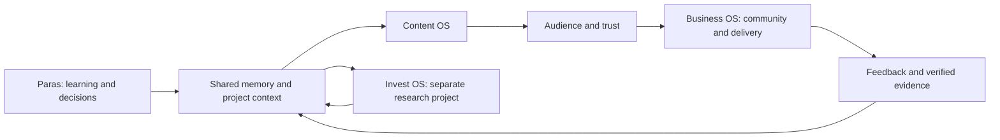

# Paras AI 2.0 structure

The machine-readable source is [os-manifest.json](os-manifest.json). The generated [capability catalog](CAPABILITIES.md) lists every role and workspace skill with its source path.

| Layer | Entry role | Owns | Roles |
|---|---|---|---|
| Content OS | content-creator | Demonstration → master asset → platform drafts → review → distribution evidence | 11 |
| Business OS | funnel-architect | Consent → customer need → offer → payment/access → delivery → retention | 17 |
| Invest OS / Money OS | portfolio-analyst | Research → written rules → simulation → risk review | 11 |
| Shared foundation | orchestrator | Context, memory, planning, tools, verification and authorized operations | 14 |

These counts describe files, not running agents. No agent is spawned unless Paras explicitly requests delegation. Specialist methods can be used in the main conversation.

## Information flow

## Working contracts

Content produces source notes, a master script/demo, resource, review state and platform drafts. Business consumes a reviewed resource and explicit opt-in; it returns real customer questions and delivery evidence. Invest research can supply educational material only after its own factual review. No pillar can treat another pillar's draft as a completed external action.

The shared foundation uses `MEMORY.md` and `memory/` for continuity, `scripts/brain.cjs` for capture/status, `scripts/ops.cjs` for business queues, and the existing dashboard for search and draft generation. Obsidian holds linked project knowledge. GHL owns contact/consent data, payment providers own billing, Skool owns learning access when verified, and WhatsApp is a communication channel.

## Capability lifecycle

Present on disk → structurally checked → exercised with representative data → externally verified where relevant → authorized for a concrete use → monitored. The catalog only establishes the first two states. Paid ads and Invest execution remain outside the current business sprint.

Before adding a role, check the catalog and whether an existing role or deterministic script can do the task. Before removing one, inspect references and preserve the original. There are no new agents in this cleanup.
